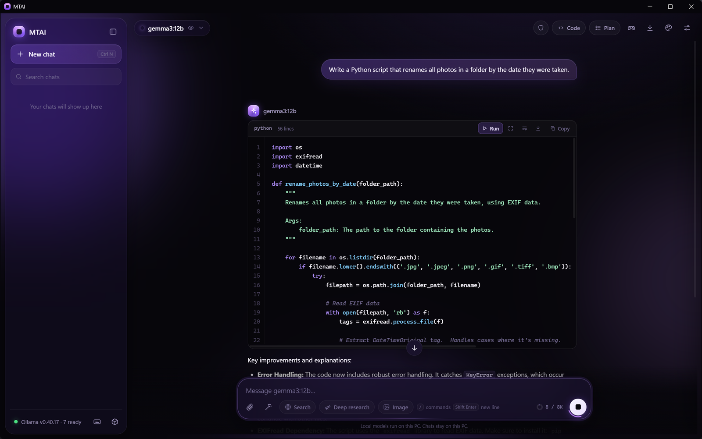
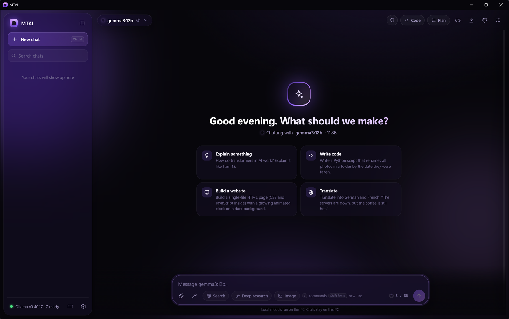

<p align="center">
  
</p>

<h1 align="center">MTAI</h1>

<p align="center">
  A private desktop chat app for the AI models on your own PC, and for cloud models with your own API keys.<br>
  Windows 10/11 · Ollama · LM Studio · llama.cpp · Claude · GPT · Gemini · Grok · and more
</p>

<p align="center">
  <a href="../../releases/latest"><b>Download MTAI.exe</b></a> ·
  <a href="#run-from-source">Run from source</a> ·
  <a href="#build-the-exe">Build the exe</a>
</p>



## Two builds

| | **MTAI.exe** | **Python source** |
|---|---|---|
| What | Compiled Windows app in one file | The open code in this repository |
| Needs | Nothing, just double-click | Python 3.10+ and `pip install -r requirements.txt` |
| Where | [Releases](../../releases/latest) | `python local_ai_chat.py` or double-click `MTAI.pyw` |
| Your data | `%LOCALAPPDATA%\MTAI\data` | `data\` next to the code |

Both builds are the same app. The exe is made from this source with PyInstaller (`packaging/`).

> The exe is not code-signed. Windows SmartScreen may say "Windows protected your PC" the first time:
> click **More info** and then **Run anyway**. Compare the file with the `MTAI.exe.sha256` checksum from the release if you want to be sure it is the original.

## Features

**Chat with your models**
- Finds models by itself: Ollama (also when the server is off), LM Studio, llama.cpp, Jan, KoboldCpp, text-generation-webui, vLLM, and `.gguf` files on disk.
- Streaming answers, thinking blocks for reasoning models, image input for vision models, file attachments.
- Model picker (`Ctrl+K`), download and delete Ollama models with progress, unload from GPU.
- Chat history with search and pinned chats, markdown with syntax highlighting, context meter.

**Cloud models with your own keys**
- OpenAI, Anthropic (Claude), Google Gemini, xAI (Grok), DeepSeek, Mistral, Groq, OpenRouter or any OpenAI-compatible URL.
- Keys are encrypted with Windows DPAPI on your PC and never shown again in full.

**Code tools**
- Code blocks get Run (Python, JavaScript, PowerShell), Preview for HTML and SVG, save, copy, wrap.
- Live preview panel with desktop/tablet/phone sizes, console and "Fix with AI".
- Code mode: the AI edits files in its own workspace with search/replace edits, and you watch every change live.

**Web, planning and pictures**
- Web search and deep research with sources, shown in a small split-screen browser (asks once before the first query).
- Plan mode: the AI writes a plan you can edit before it answers.
- Pictures: one-click image models from light and fast (SD Turbo) to heavy and detailed (SDXL, Playground v2.5), or A1111/Forge, ComfyUI and cloud image APIs. Plain requests like "draw a fox in the snow" go to the image model by themselves.

**Make it yours**
- 8 theme presets and custom colours, 4 animation levels (None / Reduced / Medium / High).
- Style tab: personas, tone, length, language, your name.
- Welcome tour, keyboard shortcuts (`Ctrl+/`), a Play menu with small AI games and toys.

**Privacy mode** (`Ctrl+Shift+L`)
- Enforced in the backend, not only hidden buttons: a Python audit hook refuses outside connections and new processes, the app window goes through a local gate proxy that refuses everything, and code runs go into an offline Windows AppContainer sandbox.
- Optional Windows Firewall rules for local AI programs (Ollama, LM Studio, llama.cpp, ComfyUI), only after you agree, with a UAC prompt, and removed again when privacy mode is turned off.
- A self-test with a diagnostics page shows what was really checked: PASS, FAIL or UNVERIFIED. MTAI never claims more than the test proved.



## Run from source

```powershell
git clone https://github.com/Leonibus2000/MTAI.git
cd MTAI
py -m pip install -r requirements.txt
py local_ai_chat.py            # or double-click MTAI.pyw (no console window)
```

`py local_ai_chat.py --browser` opens MTAI in an Edge app window instead of the native window.

You need at least one model source, for example [Ollama](https://ollama.com) with a model (`ollama pull gemma3:4b`), or an API key added in **Models > Cloud & API keys**.

## Build the exe

```powershell
py -m pip install -r requirements.txt pyinstaller pillow
powershell -ExecutionPolicy Bypass -File packaging\build_exe.ps1
```

The result is `dist\MTAI.exe` plus `dist\MTAI.exe.sha256`.

Notes for the exe:
- The Run button for Python code and the built-in image engine use an installed Python (python.org) when there is one. Everything else works without Python.
- Set `MTAI_DATA` to a folder to keep the data somewhere else (for example a portable copy on a USB stick).

## Project layout

| File | What it does |
|---|---|
| `local_ai_chat.py` | Local HTTP server, model discovery, chat streaming, code runs, the app window |
| `providers.py` | Cloud APIs with your own keys, image backends |
| `imagegen.py`, `imagegen_worker.py` | One-click image models and MTAI's own image engine |
| `netguard.py` | Privacy mode: audit hook and the browser gate |
| `sandbox.py` | Offline AppContainer sandbox for code runs in privacy mode |
| `backends.py`, `firewall.py`, `fwhelper.ps1` | Finds local AI programs, optional firewall rules |
| `privacy_check.py` | Privacy self-test and diagnostics |
| `webview_runtime.py` | Optional private WebView2 copy that can be firewalled |
| `paths.py` | Where program files and user data live (source or exe) |
| `ui/` | The HTML, CSS and JavaScript interface |
| `tests/` | Privacy unit tests and the full privacy suite |
| `packaging/` | PyInstaller spec, icon and build script |

## Tests

```powershell
py -m unittest tests.test_privacy_units     # about 20 s, no admin rights needed
py tests\privacy_suite.py                   # full privacy run in its own window
```

## License

The source code is released under the [MIT License](LICENSE).
